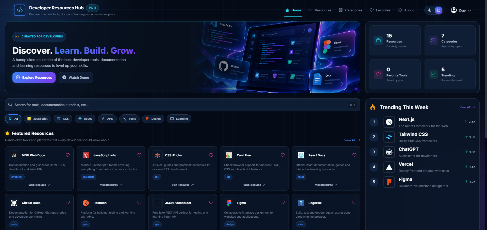

# 💻 Developer Resources Hub PRO

A modern and responsive developer resources dashboard built with **HTML, CSS and Vanilla JavaScript**.

Discover useful developer tools, documentation, learning platforms and resources from one clean interface.

---

## 🚀 Live Demo

🔗 https://johnyisbackk.github.io/js-developer-resources-hub/

---

## 🖼️ Preview

---

## ✨ Features

- 🔎 Real-time resource search
- 🗂️ Category filtering
- ❤️ Add and remove favorite resources
- 📊 Dynamic statistics
- 👀 View All / Show Less functionality
- ⌨️ Ctrl + K / Cmd + K search shortcut
- 🌙 Dark mode
- ☀️ Light mode
- 💾 Theme saved with Local Storage
- 🧭 Smooth navigation
- 🔗 Direct links to developer resources
- 📱 Fully responsive design
- 🔥 Trending resources section
- 📩 Newsletter UI section

---

## 🧠 JavaScript Features

The project uses practical Vanilla JavaScript concepts including:

- Arrays and objects
- `forEach()`
- `filter()`
- `includes()`
- `slice()`
- `push()`
- Ternary operators
- Template literals
- Dynamic rendering
- DOM manipulation
- Event listeners
- Event delegation
- `event.target`
- `event.currentTarget`
- `closest()`
- `dataset`
- `classList`
- Search filtering
- Category filtering
- Application state
- Local Storage
- Keyboard events
- Smooth scrolling

---

## 🗂️ Categories

Resources are divided into several developer categories:

- JavaScript
- CSS
- React
- APIs
- Tools
- Design
- Learning

---

## 🔎 Search & Filtering

Resources can be searched by:

- Resource name
- Description
- Category

Search and category filters work together to display only relevant resources.

---

## ❤️ Favorites

Each resource card contains a favorite button.

Users can add or remove resources from the favorites state and the favorite counter updates dynamically.

---

## 🌙 Dark & Light Mode

Developer Resources Hub PRO supports both dark and light themes.

The selected theme is saved using `localStorage`, so the preference remains after refreshing the page.

---

## ⌨️ Keyboard Shortcut

Quickly focus the search field using:

**Windows / Linux**

`Ctrl + K`

**macOS**

`Cmd + K`

---

## 📱 Responsive Design

The interface is fully responsive and optimized for:

- Desktop
- Laptop
- Tablet
- Mobile

The dashboard automatically adapts its layout depending on the available screen size.

---

## 🛠️ Built With

- HTML5
- CSS3
- Vanilla JavaScript
- Bootstrap Icons
- Devicon
- Google Fonts
- Local Storage

---

## 📁 Project Structure

Developer Resources Hub PRO

├── index.html  
├── style.css  
├── script.js  
├── images/  
│ ├── hero-image.jpg  
│ ├── newsletter-image.jpg  
│ └── preview.png  
├── README.md  
└── LICENSE

---

## 🎯 Project Purpose

The purpose of this project was to practice building a complete interactive frontend application using **Vanilla JavaScript**.

The project focuses on understanding how rendering, application state, filtering, searching, favorites and user interactions work together.

---

## 👨‍💻 Author

**Samuel Jahn**

🌐 Portfolio  
https://samueljahn.sk

💻 GitHub  
https://github.com/JohnyIsBackk

---

## 📄 License

This project is licensed under the **MIT License**.
